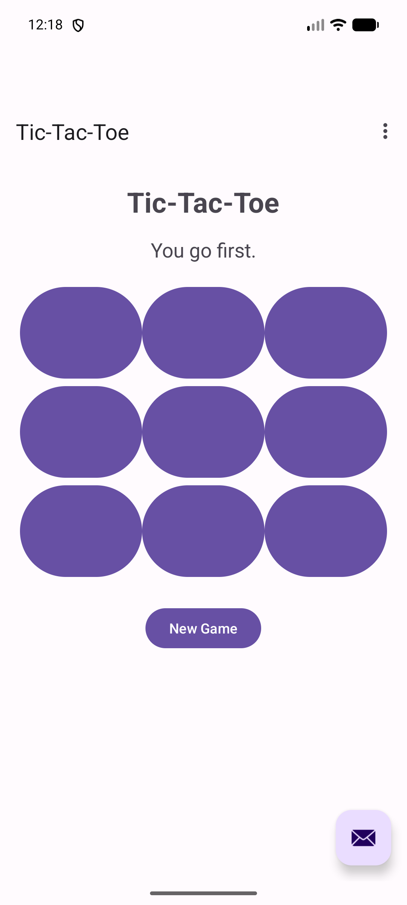
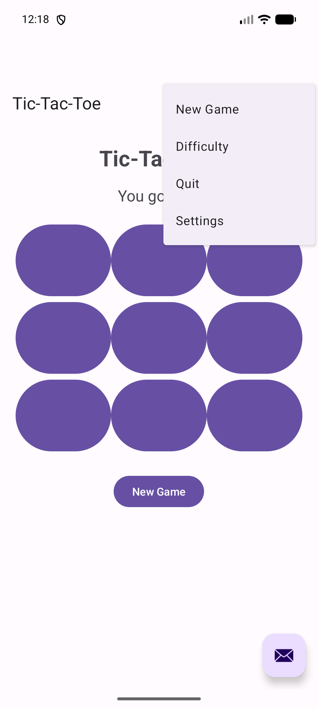
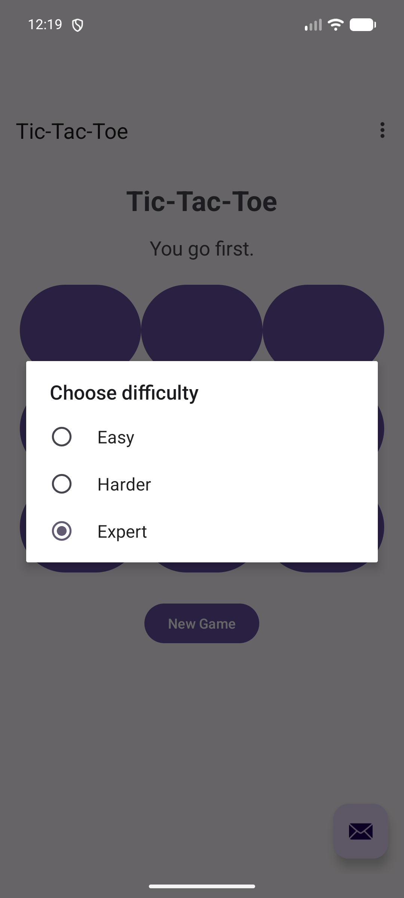
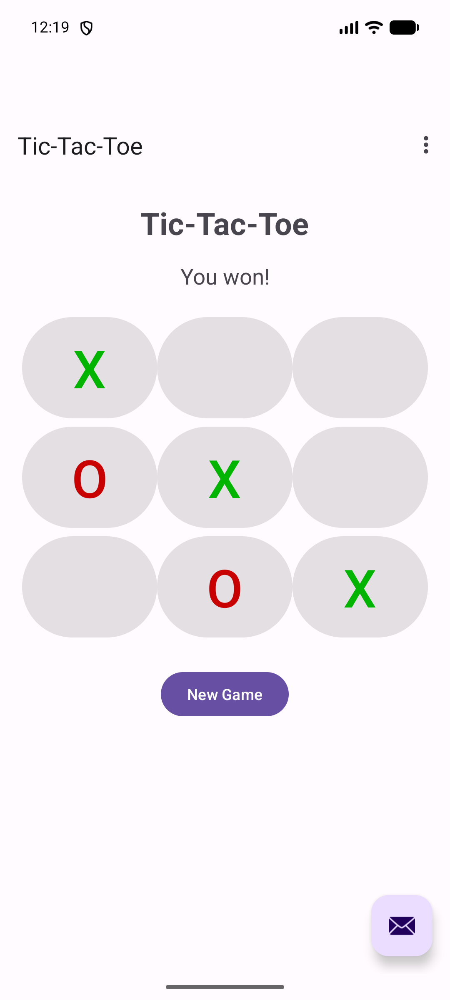
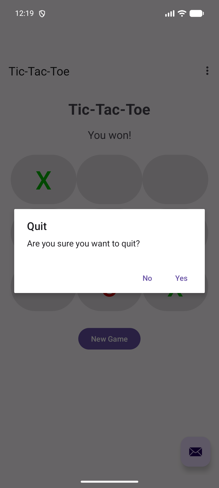

# ❌⭕ Reto 4 – Tic-Tac-Toe con menú de opciones y niveles de dificultad

> **Curso:** Desarrollo de Aplicaciones para Dispositivos Móviles · Universidad Nacional de Colombia
> **Autor y desarrollador:** Luis Alberto Castillo Sanabria
> **Plataforma:** Android (Kotlin + Fragments + View Binding)

Evolución del Triqui, ahora reescrito en **Kotlin**. Se agrega una **barra de herramientas con menú de opciones** (nueva partida, dificultad y salir) y **tres niveles de dificultad** para la inteligencia del computador.

| Inicio | Menú de opciones | Elegir dificultad |
|:---:|:---:|:---:|
|  |  |  |

| Partida ganada en fácil | Confirmar salida |
|:---:|:---:|
|  |  |

## Funcionalidades

- Menú de opciones en la barra superior: **New Game**, **Difficulty** y **Quit**.
- Tres niveles de dificultad: **Easy**, **Harder** y **Expert** (por defecto).
- Diálogo de confirmación antes de cerrar la app.
- Lógica del juego separada de la interfaz (`TicTacToeGame` / `FirstFragment`).

## Documentación

📘 **[Manual de usuario y técnico](docs/MANUAL.md)**

## Tecnologías

Kotlin · AndroidX Fragments y Navigation · View Binding · `MenuProvider` · `AlertDialog` · minSdk 24

## Cómo ejecutarlo

1. `git clone https://github.com/LCastillo9806/Reto04-TicTacToe-Menu.git`
2. Abrir en **Android Studio** y pulsar **Run ▶**.

## Autoría

Desarrollado por **Luis Alberto Castillo Sanabria** ([@LCastillo9806](https://github.com/LCastillo9806)) — Universidad Nacional de Colombia.
