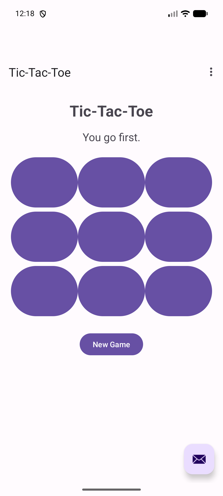
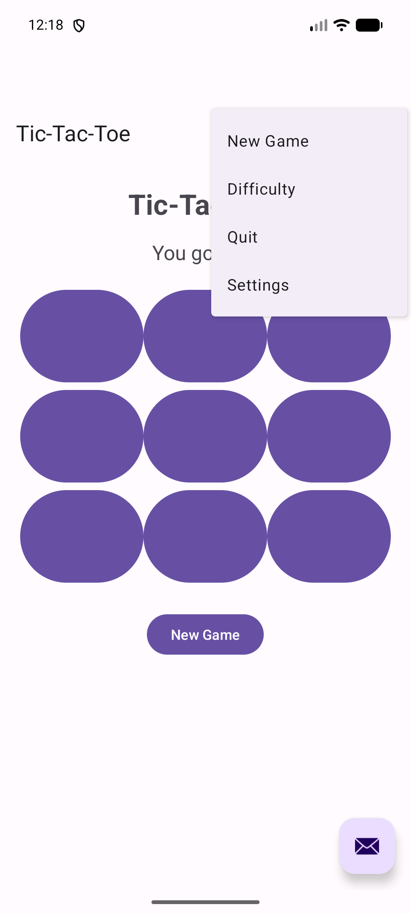
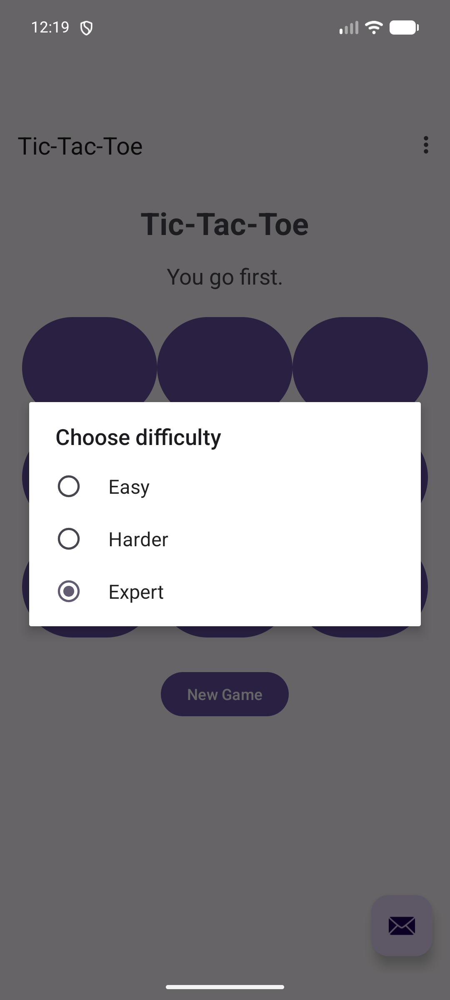
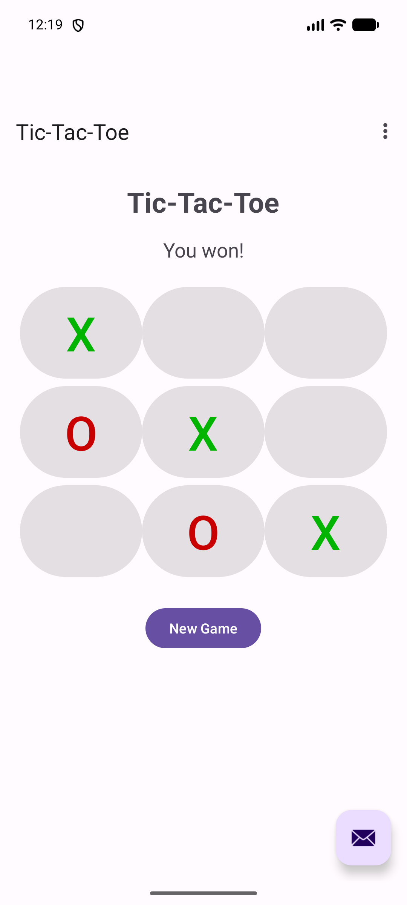
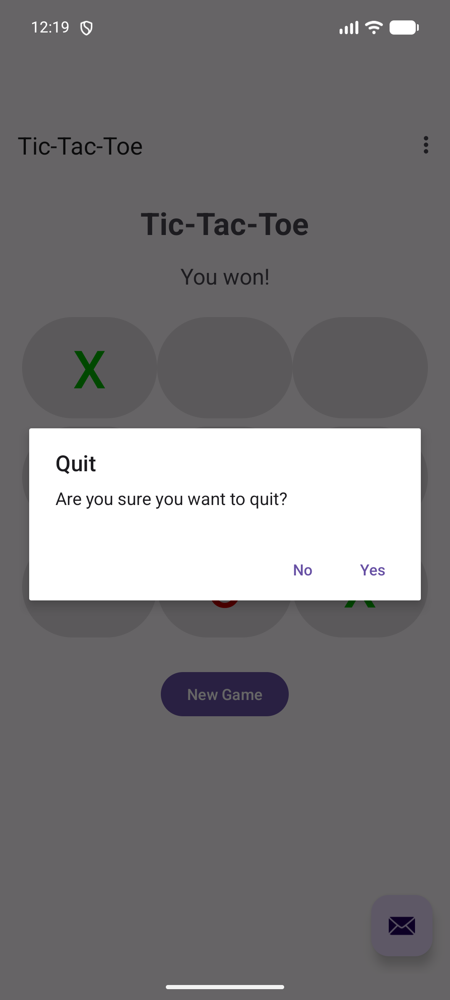

# ❌⭕ Manual de Usuario y Técnico — Reto 4: Menú de opciones y niveles de dificultad

> **Curso:** Desarrollo de Aplicaciones para Dispositivos Móviles
> **Autor y desarrollador:** Luis Alberto Castillo Sanabria
> **Institución:** Universidad Nacional de Colombia
> **Plataforma:** Android · Kotlin · Fragments · View Binding

---

## 📑 Tabla de contenidos

1. [Propósito](#1-propósito)
2. [Autoría](#2-autoría)
3. [Manual de uso](#3-manual-de-uso)
   - [3.1 Iniciar una partida](#31-iniciar-una-partida)
   - [3.2 Menú de opciones](#32-menú-de-opciones)
   - [3.3 Cambiar la dificultad](#33-cambiar-la-dificultad)
   - [3.4 Jugar y ver el resultado](#34-jugar-y-ver-el-resultado)
   - [3.5 Salir de la app](#35-salir-de-la-app)
4. [Niveles de dificultad](#4-niveles-de-dificultad)
5. [Arquitectura y código](#5-arquitectura-y-código)
6. [Compilación y ejecución](#6-compilación-y-ejecución)

---

## 1. Propósito

Este reto lleva el Triqui del Reto 3 a **Kotlin** y añade dos conceptos de interfaz:

- **Menú de opciones** en la barra de herramientas (*overflow menu*).
- **Diálogos** (`AlertDialog`) para elegir la dificultad y confirmar la salida.

Además, la inteligencia del computador se vuelve configurable con **tres niveles de dificultad**.

## 2. Autoría

| Integrante | Rol |
|:---|:---|
| **Luis Alberto Castillo Sanabria** | Autor y desarrollador |

Curso *Desarrollo de Aplicaciones para Dispositivos Móviles* — **Universidad Nacional de Colombia**.
Repositorio: <https://github.com/LCastillo9806/Reto04-TicTacToe-Menu>

## 3. Manual de uso

### 3.1 Iniciar una partida

Al abrir la app aparece el tablero vacío con el mensaje **"You go first."**. El jugador usa la **X** (verde) y Android la **O** (roja).

| Pantalla inicial |
|:---:|
|  |

### 3.2 Menú de opciones

Toca los **tres puntos (⋮)** de la esquina superior derecha para abrir el menú:

| Opción | Acción |
|---|---|
| **New Game** | Limpia el tablero y empieza otra partida |
| **Difficulty** | Abre el diálogo para elegir el nivel |
| **Quit** | Pide confirmación y cierra la app |

| Menú de opciones |
|:---:|
|  |

### 3.3 Cambiar la dificultad

1. En el menú, toca **Difficulty**.
2. Elige **Easy**, **Harder** o **Expert**. El nivel actual aparece marcado.
3. El cambio se aplica desde la siguiente jugada de Android.

| Diálogo de dificultad |
|:---:|
|  |

### 3.4 Jugar y ver el resultado

Toca una casilla libre; Android responde automáticamente. El mensaje superior indica el turno y el resultado final (**You won!**, **Android won!** o **It's a tie!**).

| Partida ganada por el jugador en nivel Easy |
|:---:|
|  |

### 3.5 Salir de la app

En el menú, toca **Quit**. Aparece el diálogo **"Are you sure you want to quit?"**: **Yes** cierra la app y **No** vuelve al juego.

| Confirmación de salida |
|:---:|
|  |

## 4. Niveles de dificultad

La función `getComputerMove()` de `TicTacToeGame` cambia su estrategia según el nivel:

| Nivel | Estrategia |
|---|---|
| **Easy** | Juega siempre al azar |
| **Harder** | Si puede ganar, gana; si no, juega al azar |
| **Expert** *(por defecto)* | Si puede ganar, gana; si no, bloquea al jugador; si no, juega al azar |

```kotlin
enum class DifficultyLevel { EASY, HARDER, EXPERT }

fun getComputerMove(): Int = when (difficultyLevel) {
    DifficultyLevel.EASY   -> getRandomMove()
    DifficultyLevel.HARDER -> getWinningMove().takeIf { it != -1 } ?: getRandomMove()
    DifficultyLevel.EXPERT -> getWinningMove().takeIf { it != -1 }
                              ?: getBlockingMove().takeIf { it != -1 }
                              ?: getRandomMove()
}
```

*(Versión resumida; en el código cada caso está desarrollado y comentado.)*

## 5. Arquitectura y código

```
MainActivity
 └─ NavHost → FirstFragment (pantalla del juego)
      ├─ MenuProvider ── options_menu.xml (New Game · Difficulty · Quit)
      ├─ AlertDialog  ── elegir dificultad / confirmar salida
      └─ TicTacToeGame (lógica)
           ├─ tablero IntArray(9)
           ├─ checkWinner()
           └─ getComputerMove()  según DifficultyLevel
```

| Archivo | Función |
|---|---|
| `app/src/main/java/co/edu/unal/tictactoe/MainActivity.kt` | Actividad principal con la barra de herramientas y la navegación |
| `app/src/main/java/co/edu/unal/tictactoe/FirstFragment.kt` | Pantalla del juego, menú, diálogos y turnos |
| `app/src/main/java/co/edu/unal/tictactoe/TicTacToeGame.kt` | Tablero, verificación del ganador e IA con niveles |
| `app/src/main/res/menu/options_menu.xml` | Opciones del menú |
| `app/src/main/res/layout/fragment_first.xml` | Diseño del tablero |

## 6. Compilación y ejecución

```bash
git clone https://github.com/LCastillo9806/Reto04-TicTacToe-Menu.git
cd Reto04-TicTacToe-Menu
./gradlew installDebug
```

O bien: abrir el proyecto en **Android Studio** y pulsar **Run ▶**.

---
*Luis Alberto Castillo Sanabria — Universidad Nacional de Colombia*
